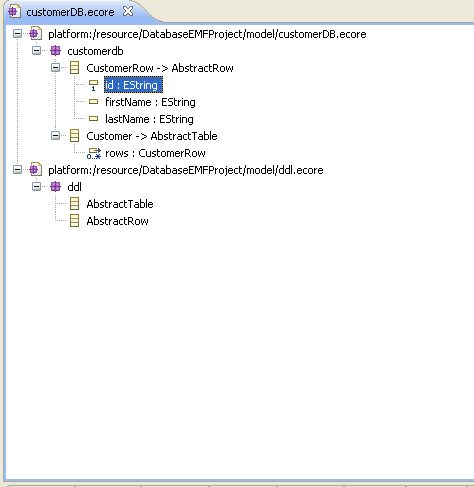
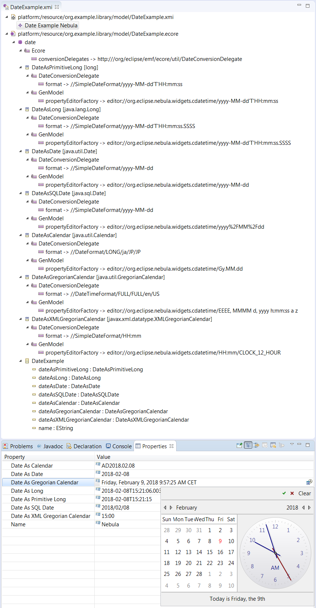

This topic gathers recipe-style solutions for common needs developers
using EMF have. __TOC__

## Code generation recipes

### Recipe: Exploiting Substitution Groups Without Polluting Your Generated API

**Problem**

You want make use of substitution groups as syntactic sugar for your
serialization to avoid the use of xsi:type without the resulting
semantic rat poison in your generated APIs, i.e., difficult-to-use
feature maps for the substitution groups. The substitution group of a
global element declaration is all the other element declaration that
directly or indirectly refer to it via the substitutionGroup attribute
on them. E.g., in the schema below, "member" is the head of a
substitution group with "file" and "folder" as its members. This allows
"file" or "folder" to be used anywhere a "member" element may appear. In
fact, because the element is abstract, a substitute must be used. Type
of an element in the substitution group must be the same as the head
element's type or a subtype thereof. Because it can be a subtype, the
type of the content for such a substitution element will be expected to
be of that subtype and for this reason, an xsi:type can be omitted from
the serialization. This is why I refer to it as syntactic sugar.
Unfortunately, in the generated API, you'll also end up with a read-only
getMembers() list for "Folder", and a getMembersGroup() feature map.
You'll need to do things like

` folder.getMembersGroup().add(ResourcePackage.Literals.DOCUMENT_ROOT__FILE, file);`

in order to add a "File" to the list of members.

**Solution**

Use ecore:ignoreSubstitutionGroups="true" in your schema.

<?xml version="1.0" encoding="UTF-8"?>

` `<xsd:schema
      xmlns:xsd="http://www.w3.org/2001/XMLSchema"
      xmlns:ecore="http://www.eclipse.org/emf/2002/Ecore"
      xmlns:resource="http://www.example.com/resource"
      ecore:ignoreSubstitutionGroups="true"
      targetNamespace="http://www.example.com/resource">

`   `<xsd:element name="fileSystem" type="resource:FileSystem"/>
`   `<xsd:complexType name="FileSystem">
`     `<xsd:sequence>
`       `<xsd:element ref="resource:folder" ecore:name="folders" maxOccurs="unbounded"/>
`     `</xsd:sequence>
`   `</xsd:complexType>

`   `<xsd:element name="member" ecore:name="members" type="resource:Resource" abstract="true"/>
`   `<xsd:complexType name="Resource" abstract="true">
`     `<xsd:attribute name="name" type="xsd:string"/>
`   `</xsd:complexType>

`   `<xsd:element name="folder" substitutionGroup="resource:member" type="resource:Folder"/>
`   `<xsd:complexType name="Folder">
`     `<xsd:complexContent>
`       `<xsd:extension base="resource:Resource">
`         `<xsd:sequence>
`           `<xsd:element ref="resource:member" ecore:name="members" maxOccurs="unbounded"/>
`         `</xsd:sequence>
`       `</xsd:extension>
`     `</xsd:complexContent>
`   `</xsd:complexType>

`   `<xsd:element name="file" substitutionGroup="resource:member" type="resource:File"/>
`   `<xsd:complexType name="File">
`     `<xsd:complexContent>
`       `<xsd:extension base="resource:Resource">
`         `<xsd:sequence>
`         `</xsd:sequence>
`       `</xsd:extension>
`     `</xsd:complexContent>
`   `</xsd:complexType>

` `</xsd:schema>

Generate as normal and modify the generated resource factory to use the
XMLResource.OPTION_ELEMENT_HANDLER option:

` /**`
`  * Creates an instance of the resource.`
`  * `
`  * `
`  * @generated NOT`
`  */`
` @Override`
` public Resource createResource(URI uri)`
` {`
`   //...`

`   result.getDefaultSaveOptions().put(XMLResource.OPTION_ELEMENT_HANDLER, new ElementHandlerImpl(false));`

`   result.getDefaultLoadOptions().put(XMLResource.OPTION_SUPPRESS_DOCUMENT_ROOT, Boolean.TRUE);`

`   return result;`
` }`

In the generated ResourceExample.java in the com.example.resources.tests
project you can now write code like this:

` Resource resource = resourceSet.createResource(URI.createURI("`<http:///My.resource>`"));`
` FileSystem fileSystem = ResourceFactory.eINSTANCE.createFileSystem();`
` Folder folder1 = ResourceFactory.eINSTANCE.createFolder();`
` fileSystem.getFolders().add(folder1);`
` folder1.setName("folder1");`
` com.example.resource.File file1 = ResourceFactory.eINSTANCE.createFile();`
` file1.setName("file1");`
` folder1.getMembers().add(file1);`
` resource.getContents().add(fileSystem);`
` resource.save(System.out, null);`
` ByteArrayOutputStream out = new ByteArrayOutputStream();`
` resource.save(out, null);`
` Resource resource2 = resourceSet.createResource(URI.createURI("`<http:///My2.resource>`"));`
` resource2.load(new ByteArrayInputStream(out.toByteArray()), null);`
` FileSystem loadedFileSystem = (FileSystem)resource2.getContents().get(0);`
` resource2.save(System.err, null);`

Deducing elements works even for the root element, so we can save
without using a document root. And because we've used
XMLResource.OPTION_SUPPRESS_DOCUMENT_ROOT, we can load without there
being a document root in the resource we've read. It reads and writes
results like this:

<?xml version="1.0" encoding="ASCII"?>

` `<resource:fileSystem xmlns:resource="http://www.example.com/resource">
`   `<resource:folder name="folder1">
`     `<resource:file name="file1"/>
`   `</resource:folder>
` `</resource:fileSystem>

### Recipe: Generating Pure API With No Visible EMF Dependencies

**Problem**

You want to generate code for an EMF model but you don't want any
references to EMF types in your API or anything else that reveals that
the API is implemented by EMF.

**Solution**

In your genmodel:

  - Set the 'Suppress EMF Types' property to 'true'; standard Java types
    will be used rather than EMF types for all accessors and operations.
    Features of type 'EObject' will be surfaced as 'java.lang.Object'
    instead. If the model includes feature maps, you will need to use
    the properties 'Feature Map Wrapper Class', 'Feature Map Wrapper
    Interface', and 'Feature Map Wrapper Internal Interface' to provide
    an alternative API. You can look as the support for SDO's Sequence
    API as the example.
  - Clear or set the value of the 'Root Extends Interface' generator
    model property. If cleared, the generated domain API will not depend
    on anything, or it can be set to an interface of your choosing so
    that root interfaces will extend this specified interface.
  - Set 'Suppress EMF Metadata' to 'true' so that only a package
    implementation class is generated, but no interface, and so that the
    generated factory interface will not extend EFactory and will have
    an INSTANCE instead of an eINSTANCE field. Alternatively, set the
    generator package's 'Metadata' property to redirect the package and
    factory interfaces to a different Java subpackage.
  - Set the 'Suppress EMF Model Tags' property to 'false' to eliminate
    the generation of the @model tags in the Javadoc.
  - Set the 'Root Extends Class' and 'Root Implements Interface'
    properties to control the generation of the implementation, but if
    you clear the first one or set it so the generated implementation is
    not a subclass of EObjectImpl, the generated code will be invalid as
    it will have unresolved references to inherited methods that will
    not be available, e.g., eGet, eSet, eUnset, eIsSet and eIsProxy.
    Generating an implementation that is pure Java is not possible with
    the default templates but can be achieved with dynamic templates.

**References**

  - Thread on the EMF newsgroup: "[Alternative superclass to
    EObject](http://www.eclipse.org/forums/index.php/m/411722/)"

-----

### Recipe: Using Multiple Namespaces in the Generated EMF Editor

**Problem**

You want to use multiple namespaces in your generated EMF editor: say
you have metamodel A with namespace mm.A which is a superset of legacy
metamodel B with namespace mm.B .

If you generate an EMF editor using namespace mm.A, it can by default
not read files which were serialized using namespace mm.B, unless you
manually edit the files to point to namespace mm.A. But all files using
metamodel B must be compatible with some legacy tool so they cannot be
changed.

Now you could rename namespace mm.A to mm.B and regenerate the editor,
but that forces you to adapt all your manual code and all your new files
using metamodel A.

**Solution**

  - You can change your plugin.xml to let the editor recognize both
    namespaces:

<extension point="org.eclipse.emf.ecore.generated_package">
`  <package`
`     uri = "mm.B"`
`     class = "mm.APackage"`
</extension>

<extension point="org.eclipse.emf.ecore.generated_package">
`  `<package
      uri = "mm.A"
      class = "mm.APackage"
      genModel = "model/A.genmodel" />
</extension>

  - If you save a model in your generated EMF editor, it will by default
    use namespace mm.A. You can change it to save using namespace mm.B
    by changing the String *eNS_URI* in src/mm.APackage (and changing
    the *@generated* tag).

**References**

  - Thread on the EMF newsgroup: "[multiple namespaces in one editor
    supported?](http://dev.eclipse.org/newslists/news.eclipse.tools.emf/msg25933.html)"

-----

### Recipe: Generating Your Own Ecore Model using a stand-alone Java App

**Problem**

You want to generate your own ecore model files programmatically using a
stand-alone command-line tool. Optionally, you also want your new model
to be able to reference ecore entities in other ecore models.

''' Example '''

Let's say you want to write a tool that reads DDL information from a
database and generates an EClass for each table that holds a collection
of row objects with an EStructuralFeature for each column. Let's say you
also have a separate ecore model that you have created by hand that
contains two EClasses called "AbstractTable" and "AbstractRow" that you
want your generated EClass to reference as an eSuperType.

So if you have a table called "Customers" that has columns "id",
"firstName" and "lastName", you want to create an ecore model like this:

`   EClass (name="Customer" eSuperTypes="AbstractTable")`
`       EReference (name="rows" type="CustomerRow" upperBound=-1)`

`   EClass (name="CustomerRow" eSuperTypes="AbstractRow")`
`       EAttribute (name="id" type="EString" ID=true lowerBound=1 upperBound=1)`
`       EAttribute (name="firstName" type="EString" upperBound=1)`
`       EAttribute (name="lastName" type="EString" upperBound=1)`

If you created the model by hand in the Ecore editor, it would look like
this:



So how would we generate this file?

**Solution**

The code is below. Here are **important** notes:

In the initStandalone() we initialize the registry that will be relied
on internally by EMF. See the [EMF
FAQ](http://wiki.eclipse.org/index.php/EMF-FAQ#How_do_I_use_EMF_in_standalone_applications_.28such_as_an_ordinary_main.29.3F)
for more information on this. This will also give you other important
setup steps like what's needed on the classpath.

In generate() it is tempting to use DDLPackage.eINSTANCE to get the ddl
package instead of createAndLoadDDLResource, but **DON'T DO IT**. If you
do, then when you save the new package, references to AbstractTable and
AbstractRow will be serialized using the nsUri of DDLPackage instead of
a path to the ecore file relative to your new file. This will cause the
Ecore editor to not be able to load your new ecore file unless
DDLPackage is already available in plugin form installed in Eclipse.
Notice that it is safe to use EcorePackage.eINSTANCE since it always
available via plugin registration in Eclipse (you could load it into the
package manually if you need to use the model from a stand-alone
program).

Also, **very important** are the two paths that you pass as arguments to
main. Note that these get passed to URI.createFileURI to set the uri on
the appropriate resources. This is important because when you save your
new package, these two uri's will be used to figure how to reference
your external ddl.ecore file (the one that declares AbstractTable and
AbstractRow). So, for example, if you pass in the arguments:

C:\\folder\\ddl.ecore C:\\folder\\newmodels\\customers.ecore

When the eSuperTypes reference is serialized in your customers.ecore
file, it will reference it like this:

`eSuperTypes="../ddl.ecore#//AbstractRow"`

Note that this means that if you open customers.ecore in the Eclipse
Ecore editor, then ddl.ecore must be in the directory above where you
put customers.ecore.

Finally, notice that the save executes to System.out rather than to the
outputPath passed in. You could change this if you want. Leaving it like
it is allows you to inspect the output before overwriting your file. As
implemented, you can simply create a new empty text file in the location
you specified for pathToOutputFile and paste the output into it.

`package com.company.my;`

`import java.io.IOException;`
`import java.util.Collections;`
`import org.eclipse.emf.common.util.URI;`
`import org.eclipse.emf.ecore.EAttribute;`
`import org.eclipse.emf.ecore.EClass;`
`import org.eclipse.emf.ecore.EClassifier;`
`import org.eclipse.emf.ecore.EPackage;`
`import org.eclipse.emf.ecore.EReference;`
`import org.eclipse.emf.ecore.EcoreFactory;`
`import org.eclipse.emf.ecore.EcorePackage;`
`import org.eclipse.emf.ecore.resource.Resource;`
`import org.eclipse.emf.ecore.resource.ResourceSet;`
`import org.eclipse.emf.ecore.resource.impl.ResourceSetImpl;`
`import org.eclipse.emf.ecore.xmi.impl.EcoreResourceFactoryImpl;`

`public class MyEMFGenerator`
`{`
`   public void generate(final String pathToDDLEcore, final String pathToOutputFile) throws IOException`
`   {`
`       // it is very important that we do everything through ResourceSet's`
`       ResourceSet resourceSet = new ResourceSetImpl();`
`       Resource ddlResource = createAndLoadDDLResource(resourceSet, pathToDDLEcore);`

`       // of course, in production code we would fail here if there were no`
`       // contents or they weren't of type EPackage.`
`       final EPackage ddlPackage = (EPackage) ddlResource.getContents().get(0);`

`       // next we will create our own new package to contained what we will generate`
`       final EPackage newPackage = createPackage("customerDB", "customerDB", "`<http://customerDB>`");`

`       // next, create the row class`
`       EClass customerRow = createEClass("CustomerRow");`
`       // add to package before we do anything else`
`       newPackage.getEClassifiers().add(customerRow);`
`       // add our super-class`
`       addSuperType(customerRow, ddlPackage, "AbstractRow");`
`       // add our features`
`       addAttribute(customerRow, "id", EcorePackage.Literals.ESTRING, true, 1, 1);`
`       addAttribute(customerRow, "firstName", EcorePackage.Literals.ESTRING, false, 0, 1);`
`       addAttribute(customerRow, "lastName", EcorePackage.Literals.ESTRING, false, 0, 1);`

`       // next, create the table class`
`       EClass customers = createEClass("Customers");`
`       // add to package before we do anything else`
`       newPackage.getEClassifiers().add(customers);`
`       // add our super-class`
`       addSuperType(customers, ddlPackage, "AbstractTable");`
`       // add our features`
`       addReference(customers, "rows", customerRow, 0, -1);`

`       // now create a new resource to serialize the ecore model`
`       Resource outputRes = resourceSet.createResource(URI.createFileURI(pathToOutputFile));`
`       // add our new package to resource contents`
`       outputRes.getContents().add(newPackage);`
`       // and at last, we save to standard out.  Remove the first argument to save to file specified in pathToOutputFile`
`       outputRes.save(System.out, Collections.emptyMap());`
`   }`

`   private void addAttribute(EClass customerRow, String name,`
`           EClassifier type, boolean isId, int lowerBound, int upperBound)`
`   {`
`       final EAttribute attribute = EcoreFactory.eINSTANCE.createEAttribute();`
`       // always add to container first`
`       customerRow.getEStructuralFeatures().add(attribute);`
`       attribute.setName(name);`
`       attribute.setEType(type);`
`       attribute.setID(isId);`
`       attribute.setLowerBound(lowerBound);`
`       attribute.setUpperBound(upperBound);`
`   }`

`   private void addReference(EClass customerRow, String name,`
`           EClassifier type, int lowerBound, int upperBound)`
`   {`
`       final EReference reference = EcoreFactory.eINSTANCE.createEReference();`
`       // always add to container first`
`       customerRow.getEStructuralFeatures().add(reference);`
`       reference.setName(name);`
`       reference.setEType(type);`
`       reference.setLowerBound(lowerBound);`
`       reference.setUpperBound(upperBound);`
`   }`

`   private EPackage createPackage(final String name, final String prefix,`
`           final String uri)`
`   {`
`       final EPackage epackage = EcoreFactory.eINSTANCE.createEPackage();`
`       epackage.setName(name);`
`       epackage.setNsPrefix(prefix);`
`       epackage.setNsURI(uri);`
`       return epackage;`
`   }`

`   private EClass createEClass(final String name)`
`   {`
`       final EClass eClass = EcoreFactory.eINSTANCE.createEClass();`
`       eClass.setName(name);`
`       return eClass;`
`   }`

`   private void addSuperType(EClass customerRow, EPackage ddlPackage,`
`           String name)`
`   {`
`        final EClass eSuperClass = (EClass) ddlPackage.getEClassifier(name);`
`        customerRow.getESuperTypes().add(eSuperClass);`
`   }`

`   private Resource createAndLoadDDLResource(ResourceSet resourceSet,`
`           String pathToDDLEcore) throws IOException`
`   {`
`       // creating a proper URI is vitally important since this is how`
`       // referenced objects in the is ecore file will be found from the ecore`
`       // file that we produce.`
`       final URI uri = URI.createFileURI(pathToDDLEcore);`
`       Resource res = resourceSet.createResource(uri);`
`       res.load(Collections.emptyMap());`
`       return res;`
`   }`

`   public static void main(String[] args) throws IOException`
`   {`
`       if (args.length < 1)`
`       {`
`           System.err.println("Usage: java MyEMFGenerator `<pathToDDLEcore>` `<outputPath>`");`
`       }`

`       final String pathToDDLEcore = args[0];`
`       final String outputPath = args[1];`

`       // note: these are extra steps that are need from main, but not if running inside Eclipse`
`       initStandalone();`

`        new MyEMFGenerator().generate(pathToDDLEcore, outputPath);`
`   }`

`   private static void initStandalone()`
`   {`
`       Resource.Factory.Registry.INSTANCE.getExtensionToFactoryMap().put("ecore", new EcoreResourceFactoryImpl());`
`       // NOTE: It is very important that you DO NOT make the call to any`
`       // EPackage.eINSTANCE's here.  Unlike in the FAQ example, we want to be sure`
`       // that all non-plugin EPackages are loaded directly from ecore files, not generated`
`       // Java classes.`
`   }`
`}`

**References**

Here's the original discussion thread with Ed Merks that spurred this
recipe:
[1](http://www.eclipse.org/newsportal/article.php?id=36884&group=eclipse.tools.emf#36884).

### Recipe: Generating enumeration-based attributes that support null

**Problem**

You want an attribute whose type is an enumeration and you want it to
support null, but EMF treats enumerations like primitives that always
take on a default value, i.e., the first enumerator of the enumeration.

**Solution**

In your Ecore model:

  - Create a new EDataType and name it <Name>Object, where <Name> is the
    name of the EEnum for which you want to support null values.
  - Set the instance type name to
    "org.eclipse.emf.common.util.Enumerator"; the generator will replace
    that with the fully qualified name of the Java enum generated from
    the EEnum.
  - For that new EDataType
      - create a contained EAnnotation,
      - set the source to
        "<http:///org/eclipse/emf/ecore/util/ExtendedMetaData>",
      - and create a Details Entry with key "baseType" and value
        "<Name>", i.e., the name of the EEnum.
  - Use this new EDataType in place of the base EEnum for any
    EAttributes for which you want to allow null.

### Recipe: Generating data types that support date/time format

**Problem**

You want a data type to represent date or time and need to control the
Java class used to represent it and the format in which it is
serialized.

**Solution**

This solution works as of EMF 2.14; builds available here: [EMF Update
Site](http://download.eclipse.org/modeling/emf/emf/builds/index.html)

In your Ecore model, follow these steps:

  - Use the context menu for your EPackage to create an EAnnotation.
      - Use the Properties view (accessible from the context menu or by
        double-clicking the annotation) to change the "Source" property
        of the annotation, using the drop-down selector for that
        property in the properties view, to the value
        "<http://www.eclipse.org/emf/2002/Ecore>".
      - The Properties view will now show the specialized properties
        available for Ecore annotations of an EPackage; use that to
        modify the Conversion Delegates property to include the value
        "<http:///org/eclipse/emf/ecore/util/DateConversionDelegate>"
        (available as a choice in the feature dialog editor).
      - You can now use this annotation source for specify date
        conversion delegates for data types in your package.
  - Create a new EDataType:
      - Set the name to whatever you like.
      - Set the instance type name to long, java.lang.Long,
        java.util.Date, java.sql.Date, java.util.Calendar,
        java.util.GregorianCalendar, or
        javax.xml.datatype.XMLGregorianCalendar; this is the Java
        representation used for your date type.
  - For that new EDataType
      - create a contained EAnnotation,
      - set the source to
        "<http:///org/eclipse/emf/ecore/util/DateConversionDelegate>"
        (which will be available in the list of choices on the
        drop-down),
      - and use the Format property to define your serialization format,
        choosing in the combo from among the proposed sample formatting
        URIs that are illustrative of what you can specify.
  - Use this new EDataType as the eType of any EAttribute.

You can use //LONG to serialize the value represented as an instant-in
time, i.e., the numerical representation of the equivalent long value.

You can use //SimpleDateFormat/<simple-date-form-pattern> to specify any
java.text.SimpleDateFormat pattern. If the representation you choose is
locale-specific, you should specify the local, e.g.,
//SimpleDateFormat/\<simple-date-format-pattern/<language>/<country>/<variant>.

You can use //DateFormat/<date-style>,
//DateTimeFormat/<date-style>/<time-style>, //TimeFormat/<time-style> to
choose the locale-specific java.util.DateFormat. In this case you must
specify a locale, e.g.,
//DateTimeFormat/<date-style>/<time-style>/<language>/<country>/<variant>
because these formats are always locale-specific.

Finally, if you specify the type java.util.Calendar, you may specify the
calendar type in the query string, e.g.,
//DateFormat/LONG/ja/JP/JP?japanese.

The <date-style> and <time-style> may each be either FULL, LONG, MEDIUM,
or SHORT.

The <language> is a two letter ISO language code, e.g., en. The
<country> is a two letter ISO country code, e.g., US. The <variant> is
optional because the locale for a /<language>/<country> may not provide
variants. It is important that you specify the locale for
locale-specific serializations to ensure that no matter in which locale
a value is formatted, it will be parsed using the locale with which it
was originally formatted.

This recipe works even on dynamic models because conversion delegates
are supported directly in the core runtime, i.e., no specialized code
will be generated for this recipe because EFactoryImpl provides the
support direclty.

## Notification Framework Recipes

### Recipe: Use EContentAdapter to receive notifications from a whole containment tree

**Problem**

You want to observe changes in a whole containment tree.

**Solution**

  - Extend org.eclipse.emf.ecore.util.EContentAdapter (MyContentAdapter)
    and add that extension as an Adapter to the Root EObject of the
    containment hierarchy that you want to observe.

<!-- end list -->

  - Override the method 'notifyChanged(Notification n)'. Inside the
    method´s body your first call must be super.notifyChanged(n) which
    adds MyContentAdapter to any new elements in the hierarchy and
    removes MyContentAdapter from any removed EObjects in the hierarchy.
    After finding out the type of the notifier Object (Remember: this
    might now be any EObject in the containment hierarchy, not just the
    EObject you initially added MyContentAdapter to - so it could be of
    any type that occurs in the containment hierarchy) you can go on by
    writing the usual notification code to find out about what feature
    changed, the type of the notification, etc.

**Example**

A simple example model org.example.library consists of an EClass
'Library' which has a containment reference 'books' of type 'Book'. The
EClass 'Book' has a String attribute 'title' and a boolean attribute
'available'. Now you want to be notified about a) new Books in the
Library and b) about changes of any book´s availability (the title of a
book usually won´t change so we exclude this feature). Using the
Solution described above we will do the following:

<code>

    import org.eclipse.emf.common.notify.Notification;

    class MyContentAdapter extends org.eclipse.emf.ecore.util.EContentAdapter {

        // start observing a Library model
        public void observeLibrary(org.example.library.Library l){
            l.eAdapters().add(this);
        }

        //override the notifyChanged method
        public void notifyChanged(Notification n){

            super.notifyChanged(n); // the superclass handles adding/removing this Adapter to new Books

            // find out the type of the notifier which could be either 'Book' or 'Library'
            Object notifier = n.getNotifier();
            if (notifier instanceof Library) {
                handleLibraryNotification(n);
            } else if (notifier instanceof Book) {
                handleBookNotification(n);
            }
        }

        // output a message about new books
        private void handleLibraryNotification(Notification n){
            int featureID = n.getFeatureID(org.example.library.Library.class);
            if (featureID == org.example.library.LibraryPackage.LIBRARY__BOOKS){
                if (n.getEventType() == Notification.ADD){
                    Book b = (Book) n.getNewValue();
                    System.out.println("New Book was added to the Library: " + b.getTitle());
                }
            }
        }

        // output a message about a book´s availability
        private void handleBookNotification(Notification n){
            int featureID = n.getFeatureID(org.example.library.Book.class);
            if (featureID == org.example.library.LibraryPackage.BOOK__AVAILABLE){
                    Book b = (Book) n.getNotifier();
                    System.out.println("The book " + b.getTitle() + " is now " + (b.isAvailable() ? "available" : "unavailable"));
            }
        }
    }

</code>

**References**

  - Thread on the EMF newsgroup:
    "[2](http://www.eclipse.org/newsportal/article.php?id=26635&group=eclipse.tools.emf#26635)"

### Recipe: Subclass EContentAdapter to receive notifications across non-containment references

**Problem**

You want to observe changes in a whole containment tree, including ones
across non-containment references.

**Solution**

  - Use the following subclass (or variation of it) to follow
    non-containment references

<code>

    import org.eclipse.emf.common.notify.Notification;
    import org.eclipse.emf.common.notify.Notifier;
    import org.eclipse.emf.ecore.EObject;
    import org.eclipse.emf.ecore.EReference;
    import org.eclipse.emf.ecore.EStructuralFeature;
    import org.eclipse.emf.ecore.util.EContentAdapter;
    import org.eclipse.emf.ecore.util.EContentsEList;

    public class CrossDocumentContentAdapter extends EContentAdapter
    {
        public CrossDocumentContentAdapter()
        {
            super();
        }

        /**
         * By default, all cross document references are followed. Usually this is
         * not a great idea so this class can be subclassed to customize.
         *
         * @param feature
         *      a cross document reference
         * @return whether the adapter should follow it
         */
        protected boolean shouldAdapt(EStructuralFeature feature)
        {
            return true;
        }

        @Override
        protected void setTarget(EObject target)
        {
            super.setTarget(target);
            for (EContentsEList.FeatureIterator<EObject> featureIterator = (EContentsEList.FeatureIterator<EObject>) target.eCrossReferences()
                                                                                                                           .iterator(); featureIterator.hasNext();)
            {
                Notifier notifier = featureIterator.next();
                EStructuralFeature feature = featureIterator.feature();
                if (shouldAdapt(feature))
                {
                    addAdapter(notifier);
                }
            }
        }

        @Override
        protected void unsetTarget(EObject target)
        {
            super.unsetTarget(target);
            for (EContentsEList.FeatureIterator<EObject> featureIterator = (EContentsEList.FeatureIterator<EObject>) target.eCrossReferences()
                                                                                                                           .iterator(); featureIterator.hasNext();)
            {
                Notifier notifier = featureIterator.next();
                EStructuralFeature feature = featureIterator.feature();
                if (shouldAdapt(feature))
                {
                    removeAdapter(notifier);
                }
            }
        }

        @Override
        protected void selfAdapt(Notification notification)
        {
            super.selfAdapt(notification);
            if (notification.getNotifier() instanceof EObject)
            {
                Object feature = notification.getFeature();
                if (feature instanceof EReference)
                {
                    EReference eReference = (EReference) feature;
                    if (!eReference.isContainment() && shouldAdapt(eReference))
                    {
                        handleContainment(notification);
                    }
                }
            }
        }

    }

</code>

**Example**

None.

**References**

  - Thread on the EMF newsgroup:
    "[3](http://www.eclipse.org/newsportal/article.php?id=32411&group=eclipse.tools.emf#32411)"

### Recipe: Derived Attribute Notifier

**Problem**

If you have a derived attribute in EMF and change one of the attributes
that the derived value depends on, then no notification will be sent for
the derived attribute - so it will not change in any editor etc. You
have to write these yourself.

**Solution**

Here's a class provided by *pvmellor*. You can specify your derived
attribute, and also which other attributes it depends on. Listeners are
then added as appropriate and when any of your dependant attributes
change, you'll fire an event for your derived attribute.

**Example**

E.g. You have a Class Library and a set of Books in it. Each Book has a
pageCount attribute. The Library has a derived attribute totalPageCount
that adds up all the pages of all the books. Then you can just write...

<code>

    /**
    * @generated NOT
    */
    protected LibraryImpl() {
    super();
    DerivedAttributeAdapter daa = new DerivedAttributeAdapter(this, MyPackage.Literals.LIBRARY__TOTALPAGECOUNT);
    daa.addNavigatedDependency(MyPackage.Literals.LIBRARY__BOOKS, MyPackage.Literals.BOOK__PAGECOUNT);
    }

</code>

Library Code:

<code>

    import java.util.ArrayList;
    import java.util.List;

    import org.eclipse.emf.common.notify.Notification;
    import org.eclipse.emf.common.notify.impl.AdapterImpl;
    import org.eclipse.emf.ecore.EObject;
    import org.eclipse.emf.ecore.EStructuralFeature;
    import org.eclipse.emf.ecore.InternalEObject;
    import org.eclipse.emf.ecore.impl.ENotificationImpl;

    public class DerivedAttributeAdapter extends AdapterImpl {
        private final InternalEObject source;
        private final EStructuralFeature derivedFeature;

        private List<EStructuralFeature> localFeatures = new ArrayList<EStructuralFeature>();

        // TODO this lot could be put into a subclass and put in a list to allow for
        // multiple navigated dependencies
        private EStructuralFeature dependantFeature = null;
        private EStructuralFeature navigationFeature = null;

        private AdapterImpl dependantAdapter = new AdapterImpl() {

            @Override
            public void notifyChanged(Notification msg) {

                if ( msg.getEventType() == Notification.SET
                        && msg.getFeature().equals(dependantFeature) ) {
                    notifyDerivedAttributeChange();
                }
            }
        };

        /*
         * Convenience constructor for a local and navigated dependency
         */
        public DerivedAttributeAdapter(EObject source, EStructuralFeature derivedFeature,
                EStructuralFeature navigationFeature, EStructuralFeature dependantFeature, EStructuralFeature localFeature) {
            this(source, derivedFeature);
            addNavigatedDependency(navigationFeature, dependantFeature);
            addLocalDependency(localFeature);
        }

        /*
         * Convenience constructor for a navigated dependency
         */
        public DerivedAttributeAdapter(EObject source, EStructuralFeature derivedFeature,
                EStructuralFeature navigationFeature, EStructuralFeature dependantFeature) {
            this(source, derivedFeature);
            addNavigatedDependency(navigationFeature, dependantFeature);
        }

        /*
         * Convenience constructor for a local dependency
         */
        public DerivedAttributeAdapter(EObject source, EStructuralFeature derivedFeature,
                EStructuralFeature localFeature) {
            this(source, derivedFeature);
            addLocalDependency(localFeature);
        }

        public DerivedAttributeAdapter(EObject source, EStructuralFeature derivedFeature) {
            super();
            this.source = (InternalEObject) source;
            this.derivedFeature = derivedFeature;
            source.eAdapters().add(this);
        }

        public void addNavigatedDependency(EStructuralFeature navigationFeature,
                EStructuralFeature dependantFeature) {
            this.dependantFeature = dependantFeature;
            this.navigationFeature = navigationFeature;
        }

        public void addLocalDependency(EStructuralFeature localFeature) {
            localFeatures.add(localFeature);
        }

        @Override
        public void notifyChanged(Notification notification) {
            if (notification.getFeature().equals( navigationFeature ) ) {
                switch (notification.getEventType()) {
                // TODO support ADD_MANY/REMOVE_MANY?
                case Notification.ADD:
                    EObject added = (EObject) notification.getNewValue();
                    added.eAdapters().add(dependantAdapter);
                    break;
                case Notification.SET:
                    EObject newValue = (EObject) notification.getNewValue();
                    EObject oldValue = (EObject) notification.getOldValue();
                    if (oldValue != null)
                        oldValue.eAdapters().remove(dependantAdapter);
                    if (newValue != null)
                        newValue.eAdapters().add(dependantAdapter);
                    break;
                case Notification.REMOVE:
                    EObject removed = (EObject) notification.getOldValue();
                    removed.eAdapters().remove(dependantAdapter);
                    break;
                default:
                    return; // No notification
                }
                notifyDerivedAttributeChange();
            } else if (localFeatures.contains(notification.getFeature())) {
                notifyDerivedAttributeChange();
            }
        }

        private void notifyDerivedAttributeChange() {
            if (source.eNotificationRequired()) {
                source.eNotify(new ENotificationImpl(source, Notification.SET,
                        derivedFeature, null, source.eGet(derivedFeature, true,
                                true)));
            }
        }
    }

</code>

**References**

  - Post on the EMF newsgroup:
    "[4](http://dev.eclipse.org/newslists/news.eclipse.modeling/msg00488.html)"
  - Post on the EMF newsgroup with Ed Merks suggested tweaks:
    "[5](http://dev.eclipse.org/newslists/news.eclipse.modeling/msg00490.html)"

**Comment**

  - When this code was posted to the EMF newsgroup, this comment was
    made: *"Here's a class I wrote that I've found useful and perhaps it
    may be useful to others"* . I take this is meaning this code has
    been given to the public domain.

## Properties Recipes

### Recipe: Create your own property editor in a generated application

**Problem**

You want to edit your model properties using your own cell editor,
rather than using EMF default one.

**Solution**

  - Create your own CustomizedPropertyDescritor that extends
    'org.eclipse.emf.edit.ui.provider.PropertyDescriptor' and overrides
    'CellEditor createPropertyEditor(Composite)'. In that method create
    your own CellEditor. Please refer to super implementation to know,
    how to enable your editor for particular types.

<!-- end list -->

  - Create your CustomizedPropertySource that extends
    'org.eclipse.emf.edit.ui.provider.PropertySource.class' and
    overrides 'IPropertyDescriptor
    createPropertyDescriptor(IItemPropertyDescriptor)'. The overidden
    method should return CustomizedPropertyDescriptor described in the
    previous paragraph.

<!-- end list -->

  - Create your CustomizedAdapterFactoryContentProvider that extends
    'org.eclipse.emf.edit.ui.provider.AdapterFactoryContentProvider' and
    overrides 'IPropertySource createPropertySource(Object,
    IItemPropertySource)' method. The overidden method should return
    CustomizedPropertySource.

<!-- end list -->

  - In your generated .editor find the XyzEditor, and then, in
    'IPropertySheetPage getPropertySheetPage()' replace the line

`propertySheetPage.setPropertySourceProvider(new
AdapterFactoryContentProvider(adapterFactory));` with a line that will
set your CustomizedAdapterFactoryContentProvider.

**Example**

<code>

```
  /**
   * This accesses a cached version of the property sheet.
   * <!-- begin-user-doc -->
   * <!-- end-user-doc -->
   * @generated NOT
   */
  public IPropertySheetPage getPropertySheetPage()
  {
    if (propertySheetPage == null)
    {
      //...

      propertySheetPage.setPropertySourceProvider
        (new AdapterFactoryContentProvider(adapterFactory)
         {
           @Override
           protected IPropertySource createPropertySource(Object object, IItemPropertySource itemPropertySource)
           {
             return
               new PropertySource(object, itemPropertySource)
               {
                 @Override
                 protected IPropertyDescriptor createPropertyDescriptor(IItemPropertyDescriptor itemPropertyDescriptor)
                 {
                   return
                     new PropertyDescriptor(object, itemPropertyDescriptor)
                     {
                       @Override
                       public CellEditor createPropertyEditor(Composite composite)
                       {
                         // Test for your case based on the feature or the type of the feature.
                         // See the super method for details.
                         //
                         Object feature = itemPropertyDescriptor.getFeature(this.object);
                         return super.createPropertyEditor(composite);
                       }
                     };
                 }
               };
           }
         });
    }

    return propertySheetPage;
  }
```

</code>

**References**

  - Thread on the search result:
    [6](http://www.eclipse.org/search/search.cgi?q=custom+cell+editor&cmd=Search%21&form=extended&wf=574a74&ps=10&m=all&t=5&ul=%2Fnewslists%2Fnews.eclipse.tools.emf&wm=wrd&t=News&t=Mail)
  - Blog on using Date control:
    [7](http://eclipser-blog.blogspot.com/2007/10/custom-property-source-for-emf.html)

### Recipe: Create a property editor factory to use declaratively in any model

**Problem**

You want to edit your model properties using your own cell editor,
rather than using EMF default one, but you want that to work in all
model editors, including reflective editors, without having to
specialize each and every one.

**Solution**

  - Create your own IPropertyEditorFactory implementation.
  - Register it in your plugin.xml.
  - Use it in on any GenDataType's Property Editor Factory or any
    GenFeature's Property Editor Factory, either in the Generator
    editor, or as GenModel annotations in your Ecore model in the Sample
    Ecore Editor.

**Example Color Cell Editor IPropertyEditorFactory Implementation**

<code>

    package org.example.color;

    import java.util.HashMap;
    import java.util.Map;
    import java.util.TreeMap;
    import java.util.regex.Matcher;
    import java.util.regex.Pattern;

    import org.eclipse.emf.common.util.URI;
    import org.eclipse.emf.ecore.EAttribute;
    import org.eclipse.emf.ecore.EDataType;
    import org.eclipse.emf.ecore.EStructuralFeature;
    import org.eclipse.emf.edit.provider.IItemLabelProvider;
    import org.eclipse.emf.edit.provider.IItemPropertyDescriptor;
    import org.eclipse.emf.edit.provider.IPropertyEditorFactory;
    import org.eclipse.emf.edit.ui.provider.EMFEditUIPropertyEditorFactory;
    import org.eclipse.jface.viewers.CellEditor;
    import org.eclipse.jface.viewers.ColorCellEditor;
    import org.eclipse.swt.SWT;
    import org.eclipse.swt.graphics.Color;
    import org.eclipse.swt.graphics.GC;
    import org.eclipse.swt.graphics.Image;
    import org.eclipse.swt.graphics.ImageData;
    import org.eclipse.swt.graphics.PaletteData;
    import org.eclipse.swt.graphics.RGB;
    import org.eclipse.swt.graphics.Rectangle;
    import org.eclipse.swt.widgets.ColorDialog;
    import org.eclipse.swt.widgets.Composite;
    import org.eclipse.swt.widgets.Control;
    import org.eclipse.swt.widgets.Display;

    /**
     * An example for how to implement an {@link IPropertyEditorFactory} that
     * supports colors.
     */
    public class ExamplePropertyEditorFactory extends EMFEditUIPropertyEditorFactory {

        /**
         * The URI for which this property editor factory is registered.
         */
        public static final URI PROPERTY_EDITOR_FACTORY_URI = URI.createURI("editor://org.example.color/");

        /**
         * The singleton instance of this property editor factory.
         */
        public static final ExamplePropertyEditorFactory INSTANCE = new ExamplePropertyEditorFactory();

        /**
         * A sample of how to support SWST style parameters for a property editor
         * factory.
         */
        private static final Map<String, Integer> SHELL_STYLES;
        static {
            Map<String, Integer> shellStyles = new TreeMap<String, Integer>();
            shellStyles.put("RESIZE", SWT.RESIZE);
            shellStyles.put("TOOL", SWT.TOOL);
            shellStyles.put("SHEET", SWT.SHEET);
            shellStyles.put("MAX", SWT.MAX);
            SHELL_STYLES = shellStyles;
        }

        /**
         * The RGB value for black.
         */
        private static final RGB BLACK = new RGB(0, 0, 0);

        /**
         * The RGB value for white.
         */
        private static final RGB WHITE = new RGB(255, 255, 255);

        /**
         * The RGB value for gray..
         */
        private static final RGB GRAY = new RGB(128, 128, 128);

        /**
         * A map of color images used by {@link #getImage(Object)}.
         */
        private static final Map<RGB, Image> IMAGES = new HashMap<RGB, Image>();

        /**
         * Returns the color image for the given object.
         *
         * @param object
         *            the object.
         * @return the color image for the given object.
         * @see #LABEL_PROVIDER
         */
        private static Image getImage(Object object) {
            RGB rgb = ExampleColorCellEditor.toRGB(object);
            if (rgb == null) {
                rgb = new RGB(0, 0, 0);
            }

            Image result = IMAGES.get(rgb);
            if (result == null) {

                // Build the image data with a palette with three colors.
                // The first is the transparent pixel, and must be different from black and the
                // rgb color.
                RGB transparent = rgb.equals(WHITE) ? GRAY : WHITE;
                PaletteData palette = new PaletteData(transparent, rgb, BLACK);
                ImageData imageData = new ImageData(14, 14, 4, palette);
                imageData.transparentPixel = 0;

                // Create the image.
                Display display = Display.getDefault();
                result = new Image(display, imageData);

                // Create a GC to draw a rectangle on the image.
                GC gc = new GC(result);
                Rectangle rectangle = new Rectangle(2, 2, 10, 10);

                // Fill with the rgb color.
                Color color = new Color(display, rgb);
                gc.setBackground(color);
                gc.fillRectangle(rectangle);

                // Draw a black rectangle around it.
                gc.setForeground(display.getSystemColor(SWT.COLOR_BLACK));
                gc.drawRectangle(rectangle);

                // Dipose the handles.
                color.dispose();
                gc.dispose();
            }
            return result;
        }

        /**
         * The stateless singleton item label provider.
         *
         * @see #createLabelProvider(Object, IItemPropertyDescriptor)
         */
        private static final IItemLabelProvider LABEL_PROVIDER = new IItemLabelProvider() {
            @Override
            public String getText(Object object) {
                return object == null ? "" : object.toString();
            }

            @Override
            public Object getImage(Object object) {
                return ExamplePropertyEditorFactory.getImage(object);
            }
        };

        /**
         * Creates an instance.
         */
        public ExamplePropertyEditorFactory() {
            super(PROPERTY_EDITOR_FACTORY_URI);
        }

        /**
         * {@inheritDoc}
         * <p>
         * This is specialized to return a {@link ExampleColorCellEditor}.
         * </p>
         */
        @Override
        public CellEditor createEditor(Object object, IItemPropertyDescriptor propertyDescriptor, Composite composite) {
            // Get the feature to check that it's a single-valued attribute.
            EStructuralFeature eStructuralFeature = getEStructuralFeature(object, propertyDescriptor);
            if (eStructuralFeature instanceof EAttribute && !eStructuralFeature.isMany()) {
                // Check that the instance type of the attribute's type is String.class.
                EAttribute eAttribute = (EAttribute) eStructuralFeature;
                EDataType eDataType = eAttribute.getEAttributeType();
                if (eDataType.getInstanceClass() == String.class) {
                    // Get the actual URI associated with this property descriptor.
                    URI propertyEditorURI = getPropertyEditorURI(object, propertyDescriptor);

                    // Extract the style from the first segment, if present.
                    int style = SWT.NONE;
                    if (propertyEditorURI.segmentCount() > 0) {
                        String styleSegment = propertyEditorURI.segment(0);
                        style = getStyle(styleSegment, SHELL_STYLES);
                    }

                    // Create the cell editor, with the style specified in the URI.
                    return new ExampleColorCellEditor(composite, style);
                }
            }
            return null;
        }

        /**
         * {@inheritDoc}
         * <p>
         * This is specialized to return images based on the color specified by the
         * value.
         * </p>
         */
        @Override
        public IItemLabelProvider createLabelProvider(Object object, IItemPropertyDescriptor propertyDescriptor) {
            return LABEL_PROVIDER;
        }

        /**
         * A color cell editor specialized to work with our property descriptor's
         * String-typed values.
         */
        public static class ExampleColorCellEditor extends ColorCellEditor {
            /**
             * The pattern for extracting the RGB value from our string repesentation of a
             * color.
             */
            private static final Pattern RGB_PATTERN = Pattern.compile("\\(([0-9]+),([0-9]+),([0-9]+)\\)");

            /**
             * The style of shell to create. This is merely an example, because
             * {@link ColorDialog} do not really support any styles.
             */
            private final int shellStyle;

            public ExampleColorCellEditor(Composite parent, int shellStyle) {
                super(parent);
                this.shellStyle = shellStyle;
            }

            /**
             * Converts the underlying RGB value to our string representation.
             *
             * @see #toString(Object)
             */
            @Override
            protected Object doGetValue() {
                return toString(super.doGetValue());
            }

            /**
             * Converts the underlying string representation to an RGB value.
             *
             * @see #toRGB(Object)
             */
            @Override
            protected void doSetValue(Object value) {
                super.doSetValue(toRGB(value));
            }

            /**
             * This is specialized because {@link #getValue()} returns a {@link String}
             * because that's the type of value the property descriptor expects. But the
             * ColorCellEditor also calls this method and it expects an {@link RGB} value,
             * so we must convert it.
             */
            protected Object openDialogBox(Control cellEditorWindow) {
                ColorDialog dialog = new ColorDialog(cellEditorWindow.getShell(), shellStyle);
                Object value = toRGB(getValue());
                if (value != null) {
                    dialog.setRGB((RGB) value);
                }
                value = dialog.open();
                return dialog.getRGB();
            }

            /**
             * Converts the value to our String representation if it is an RGB value.
             *
             * @param value
             *            the value to convert.
             * @return the converted value.
             */
            private static String toString(Object value) {
                if (value instanceof RGB) {
                    RGB rgb = (RGB) value;
                    return "(" + rgb.red + "," + rgb.green + "," + rgb.blue + ")";
                } else {
                    return (String) value;
                }
            }

            /**
             * Converts the value to an RGB value, it is our String representation.
             *
             * @param value
             *            the value to convert.
             * @return the converted value.
             */
            private static RGB toRGB(Object value) {
                if (value instanceof String) {
                    Matcher matcher = RGB_PATTERN.matcher((String) value);
                    if (matcher.matches()) {
                        String red = matcher.group(1);
                        String green = matcher.group(2);
                        String blue = matcher.group(3);
                        return new RGB(Integer.valueOf(red), Integer.valueOf(green), Integer.valueOf(blue));
                    } else {
                        return new RGB(0, 0, 0);
                    }
                } else {
                    return (RGB) value;
                }
            }
        }
    }

</code>

**Example Color Cell Editor Plugin.xml Registration**

<code>

    <extension
          point="org.eclipse.emf.edit.propertyEditorFactories">
       <factory
             class="org.example.color.ExamplePropertyEditorFactory"
             uri="editor://org.example.color/">
       </factory>
    </extension>

</code>

**Example Color Cell Editor Used as a GenModel Annotation on an
EDateType**

<code>

    <eClassifiers xsi:type="ecore:EDataType" name="ExampleDataType" instanceClassName="java.lang.String">
      <eAnnotations source="http://www.eclipse.org/emf/2002/GenModel">
        <details key="propertyEditorFactory" value="editor://org.example.color/TOOL|MAX|RESIZE"/>
      </eAnnotations>
    </eClassifiers>

</code>

**Example Color Cell Editor Result Showing Specialized Label Provider's
Color Image**


**References**

  - See also the source code of EMF's built-in IPropertyEditorFactory
    implementation,
    [NebulaDatePropertyEditorFactory](http://git.eclipse.org/c/emf/org.eclipse.emf.git/tree/plugins/org.eclipse.emf.edit.ui/src/org/eclipse/emf/edit/ui/provider/NebulaDatePropertyEditorFactory.java),
    that uses Nebula's very cool
    [CDateTime](https://www.eclipse.org/nebula/widgets/cdatetime/cdatetime.php)
    widget.

### Recipe: Use Nebula-based Cell Editors to Modify Date/Time Properties

**Problem**

You have data types that represent dates and/or times, it's super ugly
to edit them as textual properties, so you'd like to use a good cell
editor for modifying the values.

**Solution**

  - Use EMF 2.14's Nebula cell editor support.
  - The Property Editor Factory property of a GenDataType or GenFeature
    (of an attribute), can use a URI of the form following form:
        editor://org.eclipse.nebula.widgets.cdatetime/<simple-date-format-pattern>/<cdt-style1>|<cdt-style2>
    The CDT style constants are optional.
  - The example below shows data types that use each of the supported
    instance types and are annotated directly in the Ecore model with
    GenModel annotations. The DateExample class has a corresponding
    attribute for each of the data types. Because each property editor
    factory is specified directly as an annotation in the Ecore model,
    they work even in the reflective editor. The example below shows a
    dynamic instance of DateExample selected to display its properties,
    and the cell editor activated for one of the properties.

**Example Nebula IPropertyEditorFactory Usage**



### Recipe: Create an Eclipse Forms editor with widgets for your properties

**Problem**

You want to edit your model properties using a custom non-tree-based
forms editor, rather than using EMF default one.

**Solution**

  - As a starting point, grab the SimpleFormEditor from this [article on
    Eclipse
    Forms](http://www.eclipse.org/articles/Article-Forms/article.html).

<!-- end list -->

  - You need the following components to get this working:

`* ComposedAdapterFactory : this adapts all the ItemProvider stuff from the EMF-generated .edit plugin to suit your needs`
`* AdapterFactoryEditingDomain : this is the read/write interface to your model's resource, it needs the adapter factory and a command stack`
`* AdapterFactoryItemDelegator : delegates from a model element (item) to the respective item provider from the .edit plugin`
`* AdapterFactoryLabelProvider : gets text for your model elements by asking the item provider`
`* BasicCommandStack : well...a basic command stack with some undo/redo support`

  - To start implementing, open the default multi-page editor generated
    by EMF from your model. You need to merge parts of this into the
    forms editor, among them:

`* resource management code (changed, saved and removed resources as well as the resourceChangeListener and partListener)`
`* editor state management code (isDirty() and all save-related methods)`
`* methods which handle events related to the above mentioned stuff`
`* the 3 methods documented below`

  - `initializeEditingDomain()` : This method glues most of the
    above-mentioned components together. Call it in the editor's
    constructor. The XYZItemProviderAdapterFactory (generated by EMF in
    the .edit plugin) should already be added to the
    ComposedAdapterFactory (if not, add in the one you need).

<code>

```
    protected void initializeEditingDomain() {
        // Create an adapter factory that yields item providers.
        // For this to work this plugin needs the dependency on the
        // EMF edit plugin generated from the ThetaML .ecore and .genmodel
        this.adapterFactory = new ComposedAdapterFactory(
                ComposedAdapterFactory.Descriptor.Registry.INSTANCE);

        this.adapterFactory
                .addAdapterFactory(new ResourceItemProviderAdapterFactory());
        this.adapterFactory
                .addAdapterFactory(new ThetamlItemProviderAdapterFactory());
        this.adapterFactory
                .addAdapterFactory(new ReflectiveItemProviderAdapterFactory());

        // command stack that will notify this editor as commands are executed
        BasicCommandStack commandStack = new BasicCommandStack();

        // Add a listener to set the editor dirty of commands have been executed
        commandStack.addCommandStackListener(new CommandStackListener() {
            public void commandStackChanged(final EventObject event) {
                getContainer().getDisplay().asyncExec(new Runnable() {
                    public void run() {
                        editorDirtyStateChanged();
                    }
                });
            }
        });

        // Create the editing domain with our adapterFactory and command stack.
        this.editingDomain = new AdapterFactoryEditingDomain(adapterFactory,
                commandStack, new HashMap<Resource, Boolean>());

        // These provide access to the model items, their property source and label
        this.itemDelegator = new AdapterFactoryItemDelegator(adapterFactory);
        this.labelProvider = new AdapterFactoryLabelProvider(adapterFactory);
    }
```

</code>

  - `init()` : Editor initialization comprises registering for part and
    resource events and creation of your model (see below).

<code>

```
    public void init(IEditorSite site, IEditorInput editorInput)
            throws PartInitException {
        super.init(site, editorInput);
        setPartName(editorInput.getName());
        site.getPage().addPartListener(partListener);
        createModel();
        ResourcesPlugin.getWorkspace().addResourceChangeListener(resourceChangeListener,
                IResourceChangeEvent.POST_CHANGE);
    }
```

</code>

  - `createModel()` : This loads your model's resource into the editing
    domain. If you don't need the diagnostic stuff you may skip that as
    I did. After the resource is loaded, your model instance can be
    created and used.

<code>

```
    public void createModel() {

        URI resourceURI = EditUIUtil.getURI(getEditorInput());
        Resource resource = null;
        try {
            // Load the resource through the editing domain.
            //
            resource = editingDomain.getResourceSet().getResource(resourceURI,
                    true);
        } catch (Exception e) {
            resource = editingDomain.getResourceSet().getResource(resourceURI,
                    false);
        }

        if (resource != null) {
            this.modelRoot = (Your_Model_Root_Element) resource.getContents().get(0);
        }
    }
```

</code>

  - Create a new class extending FormPage and overload the constructor
    to give the class access to all components you need. This may be the
    model or parts of it, references to the form editor, the editing
    domain etc.

<!-- end list -->

  - Implement the createFormContent(IManagedForm managedForm) method of
    the form page by creating form widgets as you like. For instance,
    you may traverse your model and create a text field for every
    property.

<!-- end list -->

  - To fetch an element's property, instruct the above-mentioned
    ItemDelegator to fetch so-called "property descriptors" for this
    element. Just iterate over this list of IItemPropertyDescriptor's
    ("descriptor" is the loop variable here, it has to be final) and
    call

<code>

    EObject feature = (EObject) descriptor.getFeature(your_element_instance);

</code> Now you may introspect this feature instance and decide what
widget you want to create for it. By looking at it's feature ID, you can
discover which property the feature represents. The actual property
value you get by calling the ItemDelegator (I wrote a getter in my
editor class): <code>

    Object value = ((EObject) editor.getItemDelegator().getEditableValue(your_element_instance)).eGet(your_feature_instance)

</code> In most cases it will be a String value, so you just have to
create a text field for it: <code>

    Text text = toolkit.createText(client, valueString, SWT.SINGLE);

</code>

  - To update your model when the user modifies the value in the form,
    you have to add a mofifyListener to handle this:

<code>

```
    if (value instanceof String) {
        text.addModifyListener(new ModifyListener() {
            public void modifyText(ModifyEvent event) {
                for (IItemPropertyDescriptor descriptor2 : variablePropertyDescriptors) {
                    if (descriptor2.getId(formula).equals(descriptor.getId(formula))) {
                        String newValueText = ((Text) event.widget).getText();
                        descriptor2.setPropertyValue(formula, newValueText);
                    }
                }
            }
        });
    }
```

</code>

That's basically it. Your mileage may vary. Things left to do include
code to update the form upon resource changes.

**Explanations**

The important concept to grasp is that you interact with your model in a
very indirect way. To utilize all the nice things the EMF framework
offers out-of-the-box, you have to use its mechanics. I'm referring to
the generated XYZItemProvider classes and the accompanying adapter
factory. If you look at these you find they implement the interfaces
IItemPropertySource and IItemLabelProvider. This enables the
AdapterFactoryItemDelegator and AdapterFactoryLabelProvider to fetch
properties and label text for each item, i.e., element of your model.
They also implement IEditingDomainItemProvider which enables the
AdapterFactoryEditingDomain to delegate command creation to the
EMF-generated ItemProviderAdapter (all XYZItemProvider classes extend
this). The line where setPropertyValue is called is the important one -
here the magic happens. This call is delegated to the ItemProvider for
the element you used and a SetCommand is created, added to the command
stack we setup for our editing domain, and executed. All editor state
management like mark dirty, save, undo/redo is handled for you by EMF.

**Credit**

Most of the code was written by Eclipse EMF and Forms people, I just
merged it to get a basic forms editor working. There may be easier
and/or cleaner ways to get this done. I encourage you to add to this
recipe or correct me if I got something wrong.

**References**

  - Article on Eclipse Forms:
    [8](http://www.eclipse.org/articles/Article-Forms/article.html)
  - Example for a generic EMF Eclipse Forms editor :
    [9](http://www.conceptualprocessengineering.com/library)
  - EMF.Edit framework overview :
    [10](http://dev.eclipse.org/viewcvs/indextools.cgi/org.eclipse.emf/doc/org.eclipse.emf.doc/references/overview/EMF.Edit.html)

## EMF.Edit Recipes

### Recipe: Custom Labels

**Problem**

You want to provide customized text for an object's label in an
EMF-generated editor. Further, if the customized text is derived from
other objects and their attributes, you want the label to be updated
whenever those attribute values may change.

**Solution**

  - Modify the generated *ItemProvider.getText()* method to compose the
    value you wish.
  - If your label's value depends on other objects and their attributes:
      - Take care to test for null references and values.
      - Create a class that implements the
        *org.eclipse.emf.edit.provider.INotifyChangedListener* interface
          - An inner class of the target item provider class works well.
          - In the *notifyChanged()* method, check whether the
            notification is for one of the attributes upon which your
            custom label depends. If it is, then fire a new notification
            event whose notifier/element is your target object. Take
            care to prevent the new event from causing infinite
            recursion, remove the listener before firing the event, and
            add it back afterwards.
      - In the target item provider's constructor, create an instance of
        the above listener and add it to the adapter factory.
      - Override the *dispose()* method to remove the listener from the
        adapter factory.
  - If your label's value depends on attributes or references in the
    target object, ensure the *notifyChanged()* method in the target
    item provider fires a notification event for these cases. The
    *ViewerNotification* for these events need to indicate label
    updating.

**Example**

In this example, assume you want to customize the label for an instance
of EMF class *A*. The value is derived from an attribute, *name*, of
another class *B* that is referenced from *A*.

Modify the *getText()* method in *A's* item provider: <code>

    public class AItemProvider
        extends OperandItemProvider
        implements
            IEditingDomainItemProvider,
            IStructuredItemContentProvider,
            ITreeItemContentProvider,
            IItemLabelProvider,
            IItemPropertySource {

    ...
        /**
         * This returns the label text for the adapted class.
         * <!-- begin-user-doc -->
         * <!-- end-user-doc -->
         * @generated NOT
         */
        public String getText(Object object) {
            A aObj = (A) object;
            String ref = aObj.getB() == null ? "???" : aObj.getB().getName();
            ref = ref == null ? "???" : ref;
            return getString("_UI_A_type")+" -> "+ref; //$NON-NLS-1$
        }

</code>

Create an inner class to listen for change modifications:

<code>

```
    class ChangeListener implements INotifyChangedListener {
        public void notifyChanged(Notification notification) {
            // last target
            if(notification.getNotifier() != null &&  getTarget() != null && notification.getNotifier() == ((A) getTarget()).getB()) {
                ((IChangeNotifier) getAdapterFactory()).removeListener(this);
                fireNotifyChanged(new ViewerNotification(notification, getTarget(), false, true));
                ((IChangeNotifier) getAdapterFactory()).addListener(this);
            }
                        // other targets
            for (Notifier target : targets){
                if(notification.getNotifier() != null &&  target != null && notification.getNotifier() == ((A) target).getB()) {
                    ((IChangeNotifier) getAdapterFactory()).removeListener(this);
                    fireNotifyChanged(new ViewerNotification(notification, target, false, true));
                    ((IChangeNotifier) getAdapterFactory()).addListener(this);
                }
            }
        }
    }
```

</code> The above implementation checks that the modified object is the
same instance that the target object references (as opposed to just any
instance of *B*).

The new *VewerNotification* identifies the instance of *A* as the
changed element, and the *true* argument signals the change requires a
label update.

The *removeListener()* call prevents infinite recursion from the
following *fireNotifyChanged()*. After the event is fired, the listener
is added back to the adapter factory.

The *ChangeListener* is shared between different *A* instances, but when
it calls getTarget(), he only has the last object the itemProvider were
attached to (and not all instances). Therefore, if you choose to make
the *AItemProvider* **Statefull** (by editing the genmodel for the A
class : Properties View =\> Edit =\> ProviderType =\> Statefull), don't
add the second part of notifyChanged method (preceded by //other
targets). However, if you want to keep the *AItemProvider*
**Singleton**, this second part is necessary.

Instantiate the listener and add it to the adapter factory in the item
provider's constructor:

<code>

    public class AItemProvider
        extends OperandItemProvider
        implements
            IEditingDomainItemProvider,
            IStructuredItemContentProvider,
            ITreeItemContentProvider,
            IItemLabelProvider,
            IItemPropertySource {

        private ChangeListener changeListener;

        /**
         * This constructs an instance from a factory and a notifier.
         * <!-- begin-user-doc -->
         * <!-- end-user-doc -->
         * @generated NOT
         */
        public AItemProvider(AdapterFactory adapterFactory) {
            super(adapterFactory);
            if(adapterFactory instanceof IChangeNotifier) {
                IChangeNotifier cn = (IChangeNotifier) adapterFactory;
                changeListener = new ChangeListener();
                cn.addListener(changeListener);
            }
        }
    ...
    }

</code>

Override the *dispose()* method:

<code>

    public class AItemProvider
        extends OperandItemProvider
        implements
            IEditingDomainItemProvider,
            IStructuredItemContentProvider,
            ITreeItemContentProvider,
            IItemLabelProvider,
            IItemPropertySource {
    ...
        /* (non-Javadoc)
         * @see org.eclipse.emf.edit.provider.ItemProviderAdapter#dispose()
         */
        public void dispose() {
            super.dispose();
            if(changeListener != null) {
                ((IChangeNotifier)getAdapterFactory()).removeListener(changeListener);
            }
        }
    ...
    }

</code>

Modify the target object's item provider *notifyChanged()* to fire a
change event when the reference to *B* changes:

<code>

```
    /**
     * This handles model notifications by calling {@link #updateChildren} to update any cached
     * children and by creating a viewer notification, which it passes to {@link #fireNotifyChanged}.
     * <!-- begin-user-doc -->
     * <!-- end-user-doc -->
     * @generated NOT
     */
    public void notifyChanged(Notification notification) {
        updateChildren(notification);
        switch (notification.getFeatureID(A.class)) {
        case FooPackage.A__B:
            fireNotifyChanged(new ViewerNotification(notification, notification
                    .getNotifier(), false, true));
            return;
        }
        super.notifyChanged(notification);
    }
```

</code>

Note that the last parameter for the *ViewerNotification* constructor
indicates the label is to be updated.

**References**

None so far.

**Credits**

Mike Gering created the initial version of this recipe.

## XMI/XML Serialization Recipes

### Recipe: Data Migration

**Problem**

You need to migrate models built with prior versions of a metamodel.
Some changes to the metamodel may be handled without additional support,
for example adding an EAttribute to an existing EClass typically causes
no migration issue. Other changes require programmatic support, for
example renaming an EAttribute.

This recipe may be used to satisfy many, but not all, migration issues.
Because this recipe assumes a model can be correctly parsed as an
XMI/XML document, it fails to handle cases where, for example, an
EAttribute.ID changes.

**Solution 0** See
[11](http://wiki.eclipse.org/EMF/Recipes#Recipe:_Copying_models_from_an_EPackage_implementation_to_another_one)

**Solution 1**

See [Edapt](Edapt "wikilink").

**Solution 2**

The solution is to use extended metadata to map old metamodel elements
to new ones, and (optionally) a resource handler to deal with cases that
simple mapping doesn't solve.

Requirements:

  - The source and target models must have different namespace URIs.
  - XML references must not be based on feature names.

Steps:

  - Create an ecore2ecore mapping where the input/source is the old
    metamodel and the output/target is the new metamodel. In the IDE,
    you can right-click the old ecore file and select the "Map to
    Ecore..." menu item to launch a wizard.
  - Create an ecore2xml mapping from the ecore2ecore mapping. In the IDE
    you can right-click the ecore2ecore file created above and select
    the "Generate Ecore to XML Mapping..." menu item.
  - Create a ResourceFactory implementation (if you don't already have
    one) for your metamodel.
      - Extend org.eclipse.emf.ecore.xmi.impl.XMIResourceFactoryImpl
      - Override createResource(URI)
          - Create an instance of XMIResource
          - Set the XMLResource.OPTION_EXTENDED_META_DATA on the load
            options. For the value of this option, pass a
            lazily-initialized reference to the ecore2xml model.
          - Set the XMLResource.OPTION_RECORD_UNKNOWN_FEATURE option
            to Boolean.TRUE so you can retrieve elements that were not
            resolved after the resource is loaded.
          - Set the XMLResource.OPTION_RESOURCE_HANDLER option to a
            resource handler class you provide.
      - Implement a ResourceHandler:
          - Subclass org.eclipse.emf.ecore.xmi.impl.BasicResourceHandler
          - Override the postLoad() method to retrieve and handle the
            unknown/unresolved elements
  - Create a URI Extension Parser Registry extension
    (org.eclipse.emf.ecore.extension_parser) in your plugin manifest.
  - Package the old metamodel ecore and ecore2xml files with your
    plugin.

**Example**

The following illustrates an example ResourceFactory implementation. The
old metamodel namespace URI is "<http://www.ibm.com/vce/1.0.0/rules>",
and the new one is "<http://www.ibm.com/vce/1.0.1/rules>". <code>

    public class RulesResourceFactoryImpl extends XMIResourceFactoryImpl {

        public static final String RULES_100_NS_URI = "http://www.ibm.com/vce/1.0.0/rules";
        public static final String RULES_PLATFORM_URI = "platform:/plugin/com.ibm.myplugin/model/Rules.ecore";
        public static final String RULES_100_PLATFORM_URI = "platform:/plugin/com.ibm.myplugin/model/Rules100_2_Rules.ecore2xml";

        private ExtendedMetaData extendedMetaData;
        ...
    }

</code>

In the above fragment, several constants refer to old metamodel
namespace URI and URIs for the new metamodel ecore file and ecore2xml
file. Note that the "<platform:/plugin/>..." form indicates the ecore
and ecore2xml files will be loaded from within the deployed plugin.

The extendedMetaData field will be lazily-initialized once and reused
for creating new resource instances.

<code>

```
    public Resource createResource(URI uri) {
        XMIResource resource = (XMIResource) super.createResource(uri);

        Map defaultLoadOptions = resource.getDefaultLoadOptions();
        defaultLoadOptions.put(XMLResource.OPTION_EXTENDED_META_DATA,
                getExtendedMetaData());
        defaultLoadOptions.put(XMLResource.OPTION_RECORD_UNKNOWN_FEATURE,
                Boolean.TRUE);
        defaultLoadOptions.put(XMLResource.OPTION_RESOURCE_HANDLER,
                new RulesResourceHandler());
        return resource;
    }
```

</code> This implementation of createResource() works by creating a
instanceof XMIResource and setting various load options on it before
returning it.

<code>

```
    private ExtendedMetaData getExtendedMetaData() {
        if(extendedMetaData == null) {
            ResourceSet resourceSet = new ResourceSetImpl();
            EPackage.Registry ePackageRegistry = resourceSet.getPackageRegistry();
            ePackageRegistry.put(RULES_100_NS_URI, RulesPackage.eINSTANCE);
            ePackageRegistry.put(RULES_PLATFORM_URI, RulesPackage.eINSTANCE);
            Ecore2XMLRegistry ecore2xmlRegistry = new Ecore2XMLRegistryImpl(Ecore2XMLRegistry.INSTANCE);
            ecore2xmlRegistry.put(RULES_100_NS_URI,
                    EcoreUtil.getObjectByType(
                            resourceSet.getResource(URI.createURI(RULES_100_PLATFORM_URI),
                                    true).getContents(),
                                    Ecore2XMLPackage.Literals.XML_MAP));
            extendedMetaData = new Ecore2XMLExtendedMetaData(ePackageRegistry, ecore2xmlRegistry);
        }
        return extendedMetaData;
    }
```

</code>

The extended metadata is initialzed once for the factory.

<code>

```
    class RulesResourceHandler extends BasicResourceHandler {

        public void postLoad(XMLResource resource, InputStream inputStream, Map options) {
            final Map extMap = resource.getEObjectToExtensionMap();
            for(Iterator itr = extMap.entrySet().iterator(); itr.hasNext();) {
                Map.Entry entry = (Map.Entry) itr.next();
                EObject key = (EObject) entry.getKey();
                AnyType value = (AnyType) entry.getValue();
                handleUnknownData(key, value);
            }
        }

        private void handleUnknownData(EObject eObj, AnyType unknownData) {
            handleUnknownFeatures(eObj, unknownData.getMixed());
            handleUnknownFeatures(eObj, unknownData.getAnyAttribute());
        }

        private void handleUnknownFeatures(EObject owner, FeatureMap featureMap) {
            for (Iterator iter = featureMap.iterator(); iter.hasNext();) {
                FeatureMap.Entry entry = (FeatureMap.Entry) iter.next();
                EStructuralFeature f = entry.getEStructuralFeature();
                if(handleUnknownFeature(owner, f, entry.getValue())) {
                    iter.remove();
                }
            }
        }
        ...
    }
```

</code>

This is an example of a resource handler implementation. It overrides
the postLoad() method to handle the unknown features. Unless you want
the unknown features to be written back to the model when it is saved,
you need to remove the ones you handle from the feature map.

<code>

```
  <extension
        point="org.eclipse.emf.ecore.extension_parser">
     <parser
           class="com.ibm.adt.vce.rules.model.resource.RulesResourceFactoryImpl"
           type="rules"/>
  </extension>
```

</code>

The above plugin extension associates the resource factory with the file
extension for our models.

**Credits**

Kenn Hussey provided the base information for this recipe in a
presentation at EclipseCon 2006. Mike Gering contributed the initial
version of this recipe.

### Recipe: Encryption

**Problem**

You need to encrypt your model during read and write

**Solution**

EMF has built in encryption

Requirements:

  - None

Steps:

  - Create your own factory with the encryption properties set
  - register this factory to your model extension
  - write and load your model using this factory

**Example**

`Create an model based on the following interface.`

<code>

    package mymodel;
    import org.eclipse.emf.ecore.EObject;
    /**
     * @model
     */

    public interface IPerson extends EObject {
        /**
         * @model default="";
         */
        public String getLastname();
    }

</code> Create the following factory which sets the option for
encryption.

<code>

    package factory;
    import org.eclipse.emf.common.util.URI;
    import org.eclipse.emf.ecore.resource.Resource;
    import org.eclipse.emf.ecore.resource.impl.AESCipherImpl;
    import org.eclipse.emf.ecore.xmi.XMIResource;
    import org.eclipse.emf.ecore.xmi.impl.XMIResourceFactoryImpl;

    public class MyXMIFactoryImpl extends XMIResourceFactoryImpl {
        @Override
        public Resource createResource(URI uri) {
            XMIResourceFactoryImpl resFactory = new XMIResourceFactoryImpl();
            XMIResource resource = (XMIResource) resFactory.createResource(uri);
            try {
                resource.getDefaultLoadOptions().put(Resource.OPTION_CIPHER,
                        new AESCipherImpl("12345"));
                resource.getDefaultSaveOptions().put(Resource.OPTION_CIPHER,
                        new AESCipherImpl("12345"));
            } catch (Exception e) {
                e.printStackTrace();
            }
            return resource;
        }
    }

</code>

Create the following test class.

<code>

    package load;

    import java.io.IOException;
    import java.util.Collections;
    import java.util.Map;
    import mymodel.IPerson;
    import mymodel.MymodelFactory;
    import mymodel.impl.MymodelPackageImpl;
    import org.eclipse.emf.common.util.URI;
    import org.eclipse.emf.ecore.resource.Resource;
    import org.eclipse.emf.ecore.resource.ResourceSet;
    import org.eclipse.emf.ecore.resource.impl.ResourceSetImpl;
    import factory.MyXMIFactoryImpl;

    public class Create {
        public void create() {
            MymodelPackage.eINSTANCE.eClass();
            // Retrieve the default factory singleton
            MymodelFactory factory = MymodelFactory.eINSTANCE;

            // Create the content of the model via this program
            IPerson person = factory.createIPerson();

            person.setLastname("Lars");
            // Register the XMI resource factory for the .website extension
            Resource.Factory.Registry reg = Resource.Factory.Registry.INSTANCE;
            Map<String, Object> m = reg.getExtensionToFactoryMap();
            m.put("person", new MyXMIFactoryImpl());

            // Obtain a new resource set
            ResourceSet resSet = new ResourceSetImpl();

            // Create a resource
            Resource resource = resSet.createResource(URI
            .createURI("mymodel.person"));
            resource.getContents().add(person);

            // Now save the content.
                try {
                    resource.save(Collections.EMPTY_MAP);
                } catch (IOException e) {
                    e.printStackTrace();
                }
        }
        public void load() {
            // Initialize the model
            MymodelPackage.eINSTANCE.eClass();
            // Register the XMI resource factory for the .website extension
            Resource.Factory.Registry reg = Resource.Factory.Registry.INSTANCE;
            Map<String, Object> m = reg.getExtensionToFactoryMap();
            m.put("person", new MyXMIFactoryImpl());
            ResourceSet resSet = new ResourceSetImpl();
            Resource resource = resSet.getResource(URI
                    .createURI("mymodel.person"), true);
            try {
                IPerson person= (IPerson) resource.getContents().get(0);
                System.out.println(person.getLastname());
            } catch (Exception e) {
                e.printStackTrace();
            }
        }

        public static void main(String[] args){
            Create test = new Create();
            test.create();
            test.load();
        }
    }

</code>

**Credits** Lars Vogel wrote the initial version of this tutorial on
<http://www.vogella.de/articles/EclipseEMF/article.html#emfencryption>
and placed it into this wiki

### Recipe: Using EMF for SOAP / Compatibility between EMF XML and Axis or JAX XML

**Problem**

You need build a SOAP service and you want to use EMF. Unfortunately,
the XML generated by EMF vs the XML Generated by Axis/JAX don't seem to
be compatible.

**Solution**

EMF defaults to working with complexTypes. Axis/JAX default to working
with elements that are instances of those complex types. All you need to
do is tell EMF that you want to use elements and everything works fine.

  - Requirements:\*

None

  - Steps:\*

The most important thing is to understand the difference between a
complex type declaration and a global element declaration in XSD.

Basically the problem is that soap wants globally declared elements
where EMF simply wants complexType definitions. I think of this as SOAP
using 'instances' of types where as EMF usually works just with the
'types'.

Fortunately, EMF is brilliant and can work with the globally declared
elements that SOAP needs. You just have to tell it what you want to do.
Here's an example:

Say you have a type such as this: <code>

    <xsd:complexType name='MathCalculateRequest' >
    <xsd:complexContent>
       <xsd:extension base='com.vsp.ancillary.model.service:BaseRequest'>
        <xsd:sequence>
            <xsd:element
                name='exampleField'
                type='xsd:string'
                default='exampleValue'
            >
            </xsd:element>
        </xsd:sequence>
        </xsd:extension>
    </xsd:complexContent>
    </xsd:complexType>

</code> This is enough for EMF, but not enough for compatibility with
Axis. For Axis you also need this:

<code>

    <!-- declared globally inside your schema tag  -->
    <!-- after the complexType is defined          -->
      <xsd:element name='MathCalculateRequestTag'
                 type='com.vsp.math.model.soap:MathCalculateRequest'/>

</code> This declares that MathCalculateRequestTag is an instance of
MathCalculateRequest (the type). SOAP and Axis can work with
MathCalculateRequestTag and have no trouble at all.

Elements like this are manipulated using a DocumentRootImpl java object
that will get generated along with your model. Here's how your code will
change.

BTW, we wrap all of our EMF conversion code in a utility called
SoapUtil.convertEMFtoString() and convertStringtoEMF(). I assume you
have a similar conversion method. This technique does NOT change those
methods. However it does change what is returned as you can see here:

<code>

    // Pre-Element tag XML to EMF conversion:
    // input holds a <MathCalculateRequest>
    MathCalculateRequest foo = (MathCalculateRequest)util.convertStringToEMF(input);

</code>

<code>

    // Post-Element tag XML to EMF conversion:
    // input holds a <MathCalculateRequestTag>
    DocumentRoot docRoot = (DocumentRoot)util.convertStringToEMF(input);
    MathCalculateRequest docRoot = dt.getMathCalculateRequestTag();

</code>

All you have to do is use DocumentRootImpl and all your SOAP
compatibility problems will go away. If you read the XSD specs it makes
sense why SOAP and EMF work the ways that they do. You just need to use
the DocumentRoot as a bridge. Be aware that you need the DocumentRoot in
both directions. For example both converEMFtoString() and
convertStringToEMF() will take/return a DocumentRoot. Alternately you
might have convertEMFtoDOM() and convertDOMtoEMF() depending on if
you're using strings or DOM nodes.

**NB:** You must set the extended meta data option while loading the EMF
resource. This will cause EMF to create a DocumentRoot instance and
de-serialize the XML instance returned by the SOAP service as one of the
DocumentRoot features (the feature which corresponds to the root element
of the XML instance). If you don't set this option, EMF will try to load
a class with the same name as the root element of the XML instance-- a
class that most likely does not exist in your model. Here's how the
resource load command can be implemented.

<code>

    Map<String, Object> opts = new HashMap<String, Object>();
    opts.put(XMLResource.OPTION_EXTENDED_META_DATA, new Boolean(true));//or you could specify an ExtendedMetaData instance
    Resource resource = ...
    InputStream is = ...
    resource.load(is, opts);

</code>

EMF is FANTASTIC for doing SOAP/SOA work. The models generated are far
better than what you get with the other tooling plus it handles
references which can \*dramatically\* reduce the size of your XML
payload. With the ability to do diffs and change-tracking EMF becomes a
huge win for SOAP.

  - Suggested Reading:\*

XSD not the same as other languages, but a surprising number of SOAP
developers have only a cursory understanding of XSD. This link provides
an extremely thorough and comprehensible tour of XSD.

` `<http://www.xfront.com/xml-schema.html>

## EMF Reflective API recipes

### Recipe: Copying models from an EPackage implementation to another one

**Problem** You've got two EPackage java implementation and you want to
copy a model from one to the other.

**Solution** Create a specific EcoreUtil.Copier redefining <code>

    protected EClass getTarget(EClass class1) {
      ..
    }

</code>

and <code>

    protected EStructuralFeature getTarget(EStructuralFeature structuralFeature) {
     ..
    }

</code>

to return your target EPackages instances.

-----

## EMF databinding Recipes

### Recipe: JFace Viewers and 1:n associations

**Problem**

You need to display the n-side of a 1:n association in a JFace Viewer.
The Viewer needs to handle changes to the n-cardinality as well as
changes to the n objects themself.

**Solution**

A combination of EMF's ObservableListContentProvider and the JFace's
ObservableMapLabelProvider

Requirements:

EMF 2.4 (currently HEAD because of
[\#216440](https://bugs.eclipse.org/bugs/show_bug.cgi?id=216440))

**Example**

Display the Collection (more precisely an EList) of Addresses a Person
object owns (Person\#addresses) in a JFace TableViewer. Modifications to
the EList as well as Address objects need to be handled.

<code>

    // The model object which should be shown
    Person aPerson = ModelFactory.eINSTANCE.createPerson();
    ...

    // The content provider is responsible to handle add and
    // remove notification for the Person#address EList
    ObservableListContentProvider provider = new ObservableListContentProvider();
    viewer.setContentProvider(provider);

    // The label provider in turn handles the addresses
    // The EStructuralFeature[] defines which fields get shown
    // in the TableViewer columns
    IObservableSet knownElements = provider.getKnownElements();
    IObservableMap[] observeMaps = EMFObservables.
        observeMaps(knownElements, new EStructuralFeature[] {
        ModelPackage.Literals.PERSON_ADDRESS__STREET,
        ModelPackage.Literals.PERSON_ADDRESS__NUMBER,
        ModelPackage.Literals.PERSON_ADDRESS__ZIP,
        ModelPackage.Literals.PERSON_ADDRESS__COUNTRY);
    ObservableMapLabelProvider labelProvider =
        new ObservableMapLabelProvider(observeMaps);
    viewer.setLabelProvider(labelProvider);

    // Person#addresses is the Viewer's input
    viewer.setInput(EMFObservables.observeList(Realm.getDefault(), aPerson,
        ModelPackage.Literals.PERSON_ADDRESSES));

</code>
